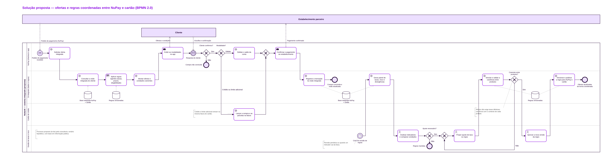

# Proposta de consultoria — Integração de informações entre NuPay e cartão de crédito

**Versão:** v1 (entrega 3, 24/11/2026) · **Limite:** 7 páginas · **Grupo:** Lucas Carvalho · Ian Magalhães · Rafael Tamasi

> Versão para a auditoria cruzada (rodada 1). Cenário hipotético, construído com informação pública; valores de taxas são fictícios e ilustrativos.

## 1. Contexto e objetivo

O NuPay é o meio de pagamento do Nubank para compras online em estabelecimentos parceiros, com três modalidades: débito, crédito (limite do cartão) e limite adicional, que é temporário, exclusivo do NuPay e sujeito a análise. As compras no crédito e no limite adicional entram na fatura do cartão de crédito.

A hipótese do cenário analisado é que dados e regras de NuPay e cartão não têm uma visão integrada. Sem esse alinhamento, fica difícil ajustar taxas e risco de forma coordenada, e soluções como parcela mínima e post purchase financing exigem mais esforço para comparar e coordenar ofertas.

**Objetivo:** desenhar e pilotar, em 16 semanas, um sistema de informação com dados e regras integrados, para que as taxas de NuPay e cartão sejam coerentes com o contexto de cada produto. Alinhar não significa ter taxas idênticas.

## 2. Desafios identificados

| ID | Desafio | Dimensão (Laudon) | Impacto |
| --- | --- | --- | --- |
| D1 | Dados do cliente divididos entre NuPay e cartão | Tecnologia | Nenhum produto vê sozinho a exposição total |
| D2 | Regras de taxas, prazos e elegibilidade definidas por produto | Administração | Condições podem divergir sem motivo claro |
| D3 | Taxa e risco ajustados sem ver o outro produto | Administração | O risco da fatura muda sem avaliação conjunta |
| D4 | Comparação de condições trabalhosa | Organização | Mais esforço para coordenar ofertas |
| D5 | Mudanças de regra sem versão nem rastreio | Tecnologia | Difícil saber qual regra valia e por quê |

## 3. Como funciona o alinhamento de taxas

Este é o centro da proposta. O detalhe completo está no anexo `alinhamento-de-taxas.md`.

**Alinhar é explicar toda diferença.** Para o mesmo cliente e prazo, as taxas de NuPay e cartão partem da mesma base e do mesmo risco. A única parte que pode diferir é um ajuste de produto, declarado, aprovado e versionado.

**Visão consolidada (S2).** Uma base única calcula, para os dois produtos, a **exposição total** do cliente, o **comprometimento mensal** da fatura (parcelas do cartão e do NuPay) e uma **faixa de risco única**.

**Fórmula comum (S3).** Toda taxa de parcelamento segue:

> **Taxa = Referência + Componente de risco + Ajuste de prazo + Ajuste de produto**

Referência (finanças), risco (risco de crédito) e prazo (política comum) são iguais nos dois produtos. Só o ajuste de produto difere, com justificativa do time do produto.

**Seis regras de coerência (S3, S4, S5).**

| Regra | Enunciado |
| --- | --- |
| R1 Mesmo risco | O componente de risco do cliente é o mesmo nos dois produtos |
| R2 Corredor | A diferença de taxa entre NuPay e cartão (e entre parcelar na compra e depois) fica dentro de um limite definido pela governança |
| R3 Risco melhor nunca paga mais | Faixa melhor nunca tem taxa maior, no mesmo produto e prazo |
| R4 Prazo maior custa mais no total | Mais parcelas nunca reduzem o custo total |
| R5 Teto de comprometimento | Parcelas mensais somadas (cartão + NuPay) abaixo do teto da faixa; se não couber, reduz prazo ou valor |
| R6 Toda oferta tem versão | Cada oferta registra a versão da regra usada |

**Na hora da compra.** O NuPay pede a oferta; o sistema lê a visão consolidada, aplica a versão vigente da fórmula, checa o corredor (R2) e o teto (R5), e o app mostra as modalidades com a versão registrada. Depois da confirmação, a visão consolidada é atualizada na hora.

**Depois da compra.** Parcela mínima e financiamento após a compra seguem o mesmo caminho, com a mesma versão. Por isso "parcelar depois" fica coerente com "parcelar na compra".

**Quando uma taxa muda.** Painel mostra a divergência → o dono do componente propõe → a simulação checa R1 a R5 nos dois produtos → a governança aprova → a nova versão é publicada **ao mesmo tempo** no NuPay e no cartão → o painel acompanha, com volta à versão anterior se preciso.

**Exemplo ilustrativo (valores fictícios).** Cliente da faixa B, compra de R$ 1.200 em 6x, com R$ 450 por mês já comprometidos. Referência 2,0% a.m., risco B +1,5 p.p., ajuste NuPay +0,3 p.p., ajuste do cartão após a compra +0,5 p.p., corredor 0,5 p.p., teto R$ 800 por mês.

| | Com integração | Sem integração (hipotético) |
| --- | --- | --- |
| Parcelar na compra (NuPay) | 3,8% a.m. · R$ 227,43/mês | 4,5% a.m. (NuPay vê o cliente como C) |
| Parcelar depois (cartão) | 4,0% a.m. · R$ 228,91/mês | 3,2% a.m. |
| Diferença | 0,2 p.p., dentro do corredor | 1,3 p.p., sem motivo de produto |
| Teto (R5) | R$ 677,43 ≤ R$ 800: oferta liberada | Não checado |

## 4. Serviços propostos

| Serviço | Objetivo | Desafios | Entregáveis principais |
| --- | --- | --- | --- |
| S1 Diagnóstico de dados e regras | Mapear dados e regras atuais dos dois produtos | D1, D2, D5 | Inventário de dados; mapa de regras; BPMN as-is |
| S2 Visão integrada do cliente | Base única com exposição, comprometimento e faixa de risco | D1, D3 | Modelo de dados; dicionário; especificação de integração |
| S3 Regras versionadas | Fórmula comum, regras R1 a R6 e fluxo de aprovação | D2, D5 | Catálogo de regras; fluxo de aprovação; matriz de responsabilidades |
| S4 Painel de taxas e risco | Leitura comum de taxas, risco e divergências | D3, D4 | Dicionário de indicadores; protótipo do painel |
| S5 Simulação de coerência | Testar mudanças nos dois produtos antes de publicar | D3, D4 | Cenários; relatório de testes das regras |
| S6 Piloto e gestão da mudança | Rodar o ciclo de revisão de taxas com um grupo piloto | D1 a D5 | Plano de piloto; treinamento; lições aprendidas |

## 5. Solução proposta

A solução tem dois fluxos, modelados em BPMN (`solucao-processo.bpmn`): a **compra coordenada**, que consulta a visão integrada e aplica as regras vigentes; e a **governança de taxas e regras**, que simula, aprova e publica regras versionadas para os dois produtos. Os dois compartilham a base integrada e o repositório de regras.

## 6. Cronograma de atividades

| Serviço | Semanas | Depende de |
| --- | --- | --- |
| S1 Diagnóstico | 1 a 3 | — |
| S2 Visão integrada | 3 a 8 | S1 |
| S3 Regras versionadas | 4 a 8 | S1 |
| S4 Painel | 7 a 11 | S2 |
| S5 Simulação | 8 a 12 | S2, S3 |
| S6 Piloto | 12 a 16 | S4, S5 |

**Marcos:** M1 diagnóstico aprovado (semana 3) · M2 base e regras definidas (semana 8) · M3 alinhamento validado, com R1 a R6 aprovadas na simulação (semana 12) · M4 piloto concluído (semana 16). **Caminho crítico:** S1 → S2 → S5 → S6. Detalhe em `cronograma.md`.

## 7. Investimento

| Serviço | Horas | Valor (R$) |
| --- | --- | --- |
| S1 Diagnóstico de dados e regras | 264 | 48.000,00 |
| S2 Visão integrada do cliente | 408 | 88.800,00 |
| S3 Repositório de regras versionadas | 340 | 68.000,00 |
| S4 Painel de taxas, risco e divergências | 340 | 63.000,00 |
| S5 Simulação de coerência | 340 | 76.000,00 |
| S6 Piloto e gestão da mudança | 350 | 69.500,00 |
| **Subtotal** | **2.042** | **413.300,00** |
| Contingência (10%) | | 41.330,00 |
| Tributos (15% sobre o valor com contingência) | | 68.194,50 |
| **Total** | | **522.824,50** |

Esforço por perfil, valores/hora e fórmulas em `planilha-custos.xlsx`; raciocínio em `prompts/03-custos-cot.md`.

## 8. Premissas e condições

- O problema é uma hipótese do cenário analisado, não uma falha comprovada do Nubank; a proposta usa só informação pública.
- Consultoria fictícia; valores/hora, contingência e tributos são premissas do grupo, editáveis na planilha.
- Valores reais de taxas, faixas, corredor e teto são decididos pelo cliente na governança, com apoio da simulação (S5).
- Pagamento sugerido por marco: 20% em M1, 30% em M2, 30% em M3 e 20% em M4.
