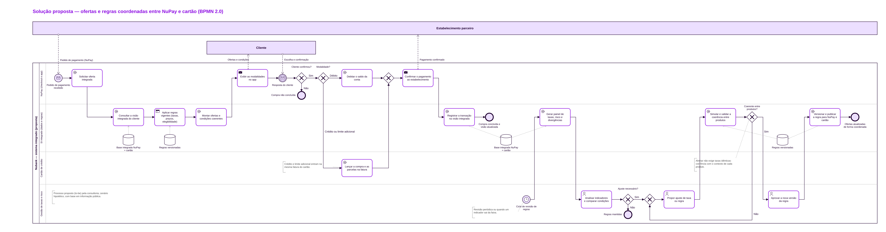

# Proposta de consultoria — Integração de informações entre NuPay e cartão de crédito

**Versão:** v0 (rascunho da entrega 2, 17/11/2026) · **Limite final:** 7 páginas
**Grupo:** Lucas Carvalho · Ian Magalhães · Rafael Tamasi

> Rascunho. As seções 5 (cronograma) e 6 (custos) entram na entrega 3, depois a proposta passa pela auditoria cruzada.

## 1. Contexto e objetivo

O NuPay é o meio de pagamento do Nubank para compras online em estabelecimentos parceiros, com três modalidades: débito, crédito (limite do cartão) e limite adicional, que é temporário, exclusivo do NuPay e sujeito a análise. As compras no crédito e no limite adicional entram na fatura do cartão de crédito.

A hipótese do cenário analisado é que dados e regras de NuPay e cartão não têm uma visão integrada. Sem esse alinhamento, fica difícil ajustar taxas e risco de forma coordenada, e soluções como parcela mínima e post purchase financing exigem mais esforço para comparar e coordenar ofertas.

**Objetivo da consultoria:** desenhar e pilotar um sistema de informação com dados e regras integrados, para que as decisões de taxas e risco de NuPay e cartão sejam coerentes com o contexto de cada produto. Alinhar não significa ter taxas idênticas.

## 2. Desafios identificados

Levantados com o Prompt 01 (zero shot) e classificados pelo modelo de Laudon e Laudon (2004).

| ID | Desafio | Dimensão | Impacto |
| --- | --- | --- | --- |
| D1 | Dados do cliente divididos entre NuPay e cartão (limite regular, limite adicional, parcelas e fatura) | Tecnologia | Nenhum produto enxerga sozinho a exposição total do cliente |
| D2 | Regras de taxas, prazos e elegibilidade definidas por produto, sem uma base comum | Administração | Condições ao mesmo cliente podem divergir sem motivo claro |
| D3 | Ajuste de taxas e risco feito sem considerar o efeito no outro produto | Administração | Uma mudança em um produto altera o risco da fatura sem avaliação conjunta |
| D4 | Comparação de condições trabalhosa, com bases e critérios diferentes | Organização | Mais esforço dos times para comparar e coordenar ofertas |
| D5 | Mudanças de regra sem versionamento e rastreio comuns | Tecnologia | Difícil saber qual regra valia, quando mudou e por quê |

## 3. Serviços propostos

Desenhados com o Prompt 02 (few shot). O detalhe de atividades, entregáveis e perfis de cada serviço está em `prompts/02-servicos-few-shot.md`.

| Serviço | Objetivo | Desafios | Entregáveis principais |
| --- | --- | --- | --- |
| S1 Diagnóstico de dados e regras | Mapear onde estão hoje os dados e as regras dos dois produtos | D1, D2, D5 | Inventário de dados; mapa de regras; BPMN as-is |
| S2 Visão integrada do cliente | Definir uma base única com histórico, limites e fatura | D1, D3 | Modelo de dados; dicionário; especificação de integração |
| S3 Repositório de regras versionadas | Reunir as regras num repositório versionado, com aprovação | D2, D5 | Catálogo de regras; fluxo de aprovação; matriz de responsabilidades |
| S4 Painel de taxas, risco e divergências | Dar uma leitura comum das condições e do risco | D3, D4 | Dicionário de indicadores; protótipo do painel |
| S5 Simulação de coerência | Avaliar o efeito de uma mudança nos dois produtos antes de publicar | D3, D4 | Critérios de coerência; cenários; relatório de testes |
| S6 Piloto e gestão da mudança | Colocar a solução em uso com um grupo piloto | D1 a D5 | Plano de piloto; treinamento; lições aprendidas |

Todo desafio é atendido por ao menos dois serviços (matriz no Prompt 02).

## 4. Solução proposta

A solução tem dois fluxos, modelados em BPMN em `item-a-proposta/solucao-processo.bpmn`:

- **Compra coordenada:** o pedido chega pelo checkout do parceiro; o sistema consulta a visão integrada do cliente, aplica as regras vigentes e monta as ofertas; o cliente confirma no app; o pagamento sai do saldo ou entra como parcelas na fatura; a transação é registrada na visão integrada.
- **Governança de taxas e regras:** um painel mostra taxas, risco e divergências; a gestão propõe ajustes; o sistema simula a coerência entre os produtos; a nova regra é aprovada, versionada e publicada para os dois produtos ao mesmo tempo.

Os dois fluxos compartilham a base integrada e o repositório de regras. É isso que mantém as decisões coerentes.

## 5. Cronograma de atividades

*Entrega 3 (24/11): cronograma por serviço, com dependências e marcos.*

## 6. Planilha de custos

*Entrega 3 (24/11): esforço por perfil e preço por serviço, estimados com o Prompt 03 (chain of thought), em `planilha-custos.xlsx`.*

## 7. Premissas

- O problema é uma hipótese do cenário analisado, não uma falha comprovada do Nubank.
- A proposta usa só informação pública sobre o NuPay e o cartão.
- Os preços serão de uma consultoria fictícia, com valor/hora definido pelo grupo.
