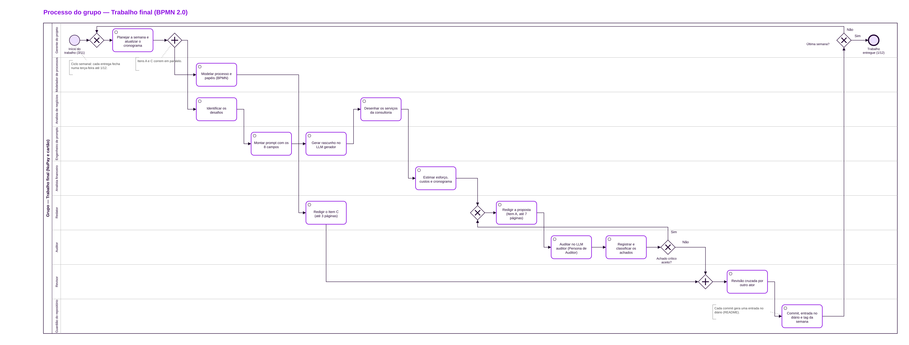

# Item C — Processo utilizado, atores e papéis

**Grupo:** Lucas Carvalho · Ian Magalhães · Rafael Tamasi · **Versão:** v1 (entrega 2, 17/11/2026) · **Limite:** 3 páginas

## 1. Objetivo do processo

Organizar como o grupo produz o trabalho final até 1/12/2026: uma entrega por semana, sempre às terças, com auditoria cruzada entre LLMs e registro de tudo no diário do repositório (Item B).

## 2. Visão geral do fluxo

O processo é um ciclo semanal, modelado em BPMN 2.0 (`processo.bpmn`), com um pool para o grupo e uma raia para cada papel.

Cada semana começa no planejamento. Em seguida, um gateway paralelo abre dois ramos que correm ao mesmo tempo: o do Item A (proposta de consultoria) e o do Item C (processo). No ramo do Item A, a proposta passa pela auditoria cruzada; se houver achado crítico aceito, volta para o redator. Os dois ramos se juntam na revisão cruzada, e a semana fecha com commit, entrada no diário e tag. Um gateway decide se o ciclo recomeça ou se o trabalho é entregue.

## 3. Etapas

| Etapa | Papel | Entrada | Saída |
| --- | --- | --- | --- |
| Planejar a semana e atualizar o cronograma | Gerente do projeto | Cronograma; achados da semana anterior | Atividades da semana |
| Modelar processo e papéis (BPMN) | Modelador de processos | Esboço e matriz de papéis | `processo.bpmn` |
| Identificar os desafios | Analista de negócios | Diagnóstico | Desafios D1 a D5 |
| Montar prompt com os 8 campos | Engenheiro de prompts | Objetivo da etapa | Arquivo em `prompts/` |
| Gerar rascunho no LLM gerador | Engenheiro de prompts | Prompt | Saída registrada |
| Desenhar os serviços da consultoria | Analista de negócios | Desafios | Serviços S1 a S6 |
| Estimar esforço, custos e cronograma | Analista financeiro | Serviços | Planilha de custos; cronograma |
| Redigir a proposta (Item A) e o Item C | Redator | Saídas acima | `proposta.md`; `item-c.md` |
| Auditar no LLM auditor | Auditor | Proposta | Achados |
| Registrar e classificar os achados | Auditor | Achados | Aceitos e rejeitados, com motivo |
| Revisão cruzada | Revisor | Itens A e C | Itens revisados |
| Commit, entrada no diário e tag | Guardião do repositório | Arquivos da semana | README atualizado; tag |

## 4. Atores e papéis

**Atores** são as pessoas reais do grupo: Lucas Carvalho, Ian Magalhães e Rafael Tamasi. **Papéis** são as funções exercidas no processo. Um ator pode exercer vários papéis, e um papel pode ser exercido por mais de um ator.

| Papel | Função |
| --- | --- |
| Gerente do projeto | Coordena o plano e as decisões do grupo |
| Analista de negócios | Traduz o diagnóstico em desafios e serviços |
| Engenheiro de prompts | Escreve os prompts e opera o LLM gerador |
| Analista financeiro | Dimensiona esforço, prazos e preços |
| Modelador de processos | Modela o fluxo do grupo e da solução |
| Redator | Escreve e ajusta os documentos de entrega |
| Auditor | Opera o LLM auditor com a Persona de Auditor |
| Revisor | Revisa o trabalho de outro ator |
| Guardião do repositório | Mantém commits, diário e tags |

**Matriz ator × papel** (P = principal; A = apoio)

| Papel | Lucas | Ian | Rafael |
| --- | --- | --- | --- |
| Gerente do projeto | P | | |
| Analista de negócios | A | P | |
| Engenheiro de prompts | A | P | |
| Analista financeiro | | A | P |
| Modelador de processos | A | | P |
| Redator | P | P | |
| Auditor | | | P |
| Revisor | P | P | P |
| Guardião do repositório | P | | |
| **Papéis por ator** | 7 | 5 | 4 |

## 5. Regras do processo

- **Gerador diferente do auditor:** quem opera o LLM gerador (Ian e Lucas) não opera o LLM auditor (Rafael), e os dois LLMs são diferentes.
- **Revisão por outro ator:** nenhum item é entregue sem a revisão de alguém que não o escreveu.
- **Diário a cada commit:** toda mudança no repositório gera uma entrada no README no mesmo commit, com data, autor, item, arquivos e LLM usado.
- **Limites de páginas:** Item A até 7 páginas e Item C até 3, medidos no PDF final.

## 6. Ferramentas

GitHub (repositório e diário), BPMN 2.0 editado no demo.bpmn.io ou no Camunda Modeler, planilha de cronograma e papéis (`planejamento/cronograma-e-papeis.xlsx`) e dois LLMs: um gerador e um auditor.
